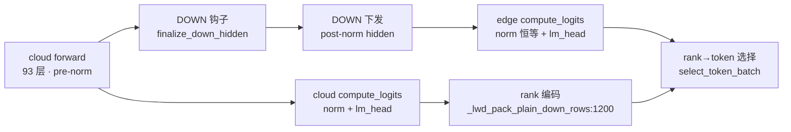

# LWD 适配 Kimi K3 设计方案（v2）

| | |
| --- | --- |
| 状态 | 评审稿 v2.7（评审记录见 PR 描述；本文件为两仓 MR1/MR2/MR3 的设计基线；v2.7 为实施期修正：weight filter 的等值断言与 K3 命名矩阵同属 MR1——二者同文件，拆开会让 MR1/MR3 文件集重叠；MR3 仅剩 split 测试与文档） |
| 基线 | vllm `data/main` = `fa61204aa6`；vllm-ascend `main` = `98edbcf1c` |
| RFC | 不需要：非测试代码约 89–119 行（<500 行门槛，见 §5.4） |
| 关联 | [lwd_role_module_skip.md](lwd_role_module_skip.md)（归属表）、[lwd_weight_split.md](lwd_weight_split.md)（离线切分）、[lwd_migration_overview.md](lwd_migration_overview.md)、[lwd_host_staging.md](lwd_host_staging.md) |
| 落位 | 本文件（`vllm/docs/design/k3.md`，vllm 仓；MR2 在 vllm-ascend 仓） |

**结论速览**：共 **3 个必选 MR**（vllm 2 个 + vllm-ascend 1 个）+ **1 个可选验证 MR**；代码+测试约 **292 行**（新增毛数）、文档约 **300 行**（即本档）。MR1 与 MR2 必须同一发布窗口合入（§5.2）；MR3 单向依赖 MR1（§5.2）。MR1/MR2/MR3 三者文件集两两不重叠（MR1 含 split 脚本的快照+docstring，MR3 只含测试与文档）。

## 0. 与 v1 的差异摘要

| # | v1 说法 | v2 结论 | 依据 |
| --- | --- | --- | --- |
| 1 | F1 后果是「边端报错 / 二次归一」 | 两者都不成立：`PPMissingLayer` 恒等、加守卫不崩；真实现状是**边端装载期已丢 norm 权重 + 真实 RMSNorm 单位权重 → 静默数值漂移**（量化装载静默，bf16 会 fail-fast） | §3.1 |
| 2 | 修法：cloud forward 尾部归一 + `compute_logits` 按 `lwd_role()` 跳过 | 两处 `lwd_role()` 都在运行时读 `None`，是**死代码**；改为**构建期守卫 + DOWN 打包钩子** | §3.1、§4.3 |
| 3 | 归属表新增 2 行（`vision_tower`/`mm_projector`） | **4 行**：另需 `output_attn_res_norm`/`output_attn_res_proj`，否则 MR3 切分仍 `RuleCoverageError`（exit 3） | §3.2、§4.1 |
| 4 | 当前守卫覆盖含 GLM-4.5V | GLM-4.5V 无构建期守卫（`glm4_1v.py:1810`），只有装载期/角色判断受益 | §3.2 |
| 5 | AMD 侧改 `amd/model.py` | norm 在 `amd/linear.py:698`，`compute_logits` 在 `:1076-1082` | §4.2 |
| 6 | ckpt 命名「GLM 式 `model.language_model.*`」 | K3 实为 `language_model.model.*` / `vision_tower.*` / `mm_projector.*` / `lm_head.*` | §2.4 |
| 7 | 范围只写 vllm 仓 | **两仓**：vllm（表/守卫/钩子/回归）+ vllm-ascend（NPU 真机构造点守卫 + 钩子调用） | §5 |
| 8 | 无 MR 改动量 | 本版补 §5：3+1 个 MR，逐文件 LOC 估算 | §5 |

---

## 1. 目标与范围

**目标**：K3 可在 LWD 边云拓扑（`prefill_only`，两侧 pp=1 集中式）下正确部署；文本与多模态请求与非 LWD 数值一致；非 LWD 部署行为零变化。

**范围**：

- vllm：归属表扩容、K3 构建期守卫（nvidia/amd）、DOWN 归一钩子、装载期/切分的回归测试；
- vllm-ascend：`AscendKimiLinearModel`/`AscendKimiK3ForConditionalGeneration` 的构造点守卫、云侧 runner 的钩子调用点。

**明确不做**：

- 不改 K3 视觉属性名（方案 B）：会侵入上游模型结构与 ckpt 映射；
- 不在 runner/filter 里做模型特判（方案 C）：违反单一事实源；
- 不覆盖 Ascend 的 KDA/MoE kernel 适配：vllm-ascend 已有完整 K3 实现，本方案只补 LWD 相关的两个缺口。

## 2. K3 结构事实（代码核实）

### 2.1 注册与目录

`registry.py` 注册 4 个类：`KimiLinearForCausalLM`（:146）、`KimiK3ForConditionalGeneration`（:480）、`K3DSparkModel`（:653，实现 `K3DSparkForCausalLM`）、`KimiK3MTPModel`（:704，实现 `KimiK3MTP`）。目录 `vllm/models/kimi_k3/{common,nvidia,amd}`，多模态入口 `docs/models/supported_models.md`（T + I）。

### 2.2 文本侧

- `KimiLinearModel`（`nvidia/model.py:1139`）：93 层（ckpt 规格，见 §2.5），MLA + KDA 混合（`IsHybrid`），Attention Residuals（`attn_res_block_size`，v1 称 block 12），LatentMoE；标准 1D RoPE（`mla.py:172`），无 M-RoPE。
- **final norm 在 `compute_logits` 里做**（`nvidia/model.py:1720-1727`），forward 末尾**不归一**（`:1449-1452` 注释写明：让 MTP draft 拿到 pre-norm hidden）。`self.norm` 建于 `:1209`（受 `is_last_rank` 控制，LWD 两侧都是 last rank）。
- attn-res 配套模块 `output_attn_res_norm`/`output_attn_res_proj`（`:1211/:1214`，仅 `use_attn_res` 为真时创建）。

### 2.3 视觉侧

`MoonViT3dPretrainedModel`（`vision_tower`，`:1814`）+ `KimiK25MultiModalProjector`（`mm_projector`，`:1855`），patchmergerv2、2×2 merge（`configs/kimi_k3.py:27,31`）。模型侧占位符 `<|kimi_image_placeholder|>`，processor 侧 `<|media_pad|>`（`common/mm_preprocess.py:113-129`）。

### 2.4 权重命名

`language_model.model.*`（layers/norm/embed_tokens）、`vision_tower.*`、`mm_projector.*`、`lm_head.*`。`hf_to_vllm_mapper` 只有两条前缀改写（`nvidia/model.py:1774-1784`），据此可反推命名。

### 2.5 规格（来自官方 config，**未在仓内核对**）

| 项 | 值 | 仓内可核 |
| --- | --- | --- |
| 总参/激活 | 2.8T / 104B，896 experts top-16 + 2 shared | 93 层/896 experts 与 vllm-ascend `Kimi-K3.md` 一致 |
| 层数 | 93（24 full + 69 KDA） | 机制支持（`configs/kimi_linear.py:118-121`），数值不可核 |
| 上下文/精度 | 1M tokens，bf16，官方权重 mxfp4（仅 routed experts） | 不可核 |
| 多模态 | ViT + patchmergerv2（2×2 merge） | 可核（§2.3） |
| 投机 | `num_nextn_predict_layers: 0` | 默认值一致（`kimi_linear.py:49`），ckpt 不可核 |

> MR3 时应 dump `model.safetensors.index.json` 核对，核对前不把上表当代码事实。

## 3. 冲突与修法

### 3.1 F1：norm 语义（核心风险）

**约定**：归属表把 `model.norm` 归 cloud，云侧在 DOWN 前完成 final norm，边端 `compute_logits` 不再归一。

**K3 现状与故障链**：

1. 归属表 `model.norm → cloud` 已生效：edge 角色的装载过滤按 `_matches_module_suffix` 命中 `language_model.model.norm.weight`（`lwd_weight_filter.py:26-39`）→ **权重被丢弃**；
2. 边端无守卫，`is_last_rank` 为真 → 构建**真实 RMSNorm**，权重保持 `torch.ones` 初始化（`layernorm.py:63`）；
3. 云端 forward 输出 pre-norm（§2.2）→ DOWN；边端以**单位权重**归一 → **静默数值漂移**；
4. 量化装载（官方 mxfp4）下 `track_weights_loading` 默认关闭 → 无任何报错；bf16 装载会 `ValueError: Following weights were not initialized`（`default_loader.py:471-488`）。可强制 `model_loader_extra_config.enable_weights_track` 把「丢权重」变成装载期断言（豁免只覆盖量化模块，RMSNorm 不在其中）。

**为什么不能按 v1 修**：v1 在 `compute_logits` 与 `forward` 尾部各写一处 `lwd_role()` 判断。`lwd_role()` 读进程全局 config，仅 `set_current_vllm_config` 窗口内有值（`utils.py:911-917`），运行时为 `None` → forward 归一分支**永不执行**、compute_logits 分支落到 PPMissingLayer 恒等 → 结果是**完全未归一**。两处都是死代码。

**修法**：构建期守卫（edge 不建 `model.norm`，恒等 forward 使 `compute_logits` 的调用自然变 no-op）+ 云端 DOWN 打包前归一（§4.3）。forward 不动，MTP/draft 继续拿 pre-norm。

### 3.2 F2：视觉塔命名（4 类未归属张量）

归属表键是 `visual`，K3 是 `vision_tower`/`mm_projector`，点边界后缀匹配不上。按切分脚本 `_tensor_matches_module` 的路由逻辑，K3 权重中恰好 **4 个家族 uncovered**：

| 张量家族 | 归属 | 现状 |
| --- | --- | --- |
| `vision_tower.*` | edge | 无行 → 切分 `RuleCoverageError`(exit 3) |
| `mm_projector.*` | edge | 同上 |
| `output_attn_res_norm.*` | cloud | 同上（MR1 加完视觉两行后的下一批） |
| `output_attn_res_proj.*` | cloud | 同上 |

其余 `language_model.model.{embed_tokens,layers,norm}` 与 `language_model.lm_head` 已被现有行兜住。今天切分跑不通（exit 3），这批行是切分验收的前置条件。

**影响面**：`self.vision_tower =` 在 vllm 里有 **25 个模型文件**同名（llava 系、gemma3/4_mm、minimax_m3、aria、paligemma、mistral3、kimi_k25、kimi_vl…）。因此「纯扩展、存量模型行为不变」的正确表述是「**当前不在 LWD 支持列表**的模型行为不变」；**表行必须与该模型的构建守卫成对交付**，否则云侧会出现「权重被过滤、模块仍构建」的未初始化参数（与 F1 同型）。

旁注（v1 说对了）：runner / `encoder_budget` / `input_processor` 用 `lwd_skips_module("visual", role)` 做**角色判断**（只看表），对 K3 仍正确，无需改。

### 3.3 F3：投机（MTP / DSpark）

- MTP：`SharedHead` 自带 norm，`KimiK3MultiTokenPredictorLayer.forward` 先归一（`nvidia/mtp.py:145-155`），`compute_logits`（`:203-211`）只做 `logits_processor(shared_head.head, ...)` → **干净**；
- DSpark：`K3DSparkForCausalLM.compute_logits`（`nvidia/dspark_mla.py:481-484`）不含 norm → **干净**（不同于 DeepSeek-V4 dspark 的反例）；
- MTP 是**独立 draft 模型类**（`KimiK3MTP`）。edge 不启投机即不构建，**没有守卫站点**；归属表 `model.mtp` 行对 K3 不产生实际作用。

## 4. 详细设计

### 4.1 归属表扩容（4 行）

`vllm/model_executor/models/utils.py`（`LWD_MODULE_OWNERSHIP`）：

```python
    "vision_tower": frozenset(("edge",)),
    "mm_projector": frozenset(("edge",)),
    # K3 final-norm 家族的 attn-res 尾巴：只在云端 forward 里使用
    "output_attn_res_norm": frozenset(("cloud",)),
    "output_attn_res_proj": frozenset(("cloud",)),
```

装载期过滤与离线切分由同一张表自动派生，**无需改这两个脚本的逻辑**；但 `split_lwd_checkpoint.py` 里有一份供无 vllm 环境使用的 **vendored 字面副本**（`_VENDORED_MODULE_OWNERSHIP`，`:170-176`），必须与表行在**同一个 commit** 里同步 +4——`test_vendored_ownership_table_equals_live_table`（AST 解析 live 表，不依赖 torch）会在 MR1 自己的 CI 上断言两者相等。

### 4.2 构建期守卫与钩子落点（4 类构造点 × 3 份实现）

| 构造点 | vllm nvidia | vllm amd | vllm-ascend |
| --- | --- | --- | --- |
| `model.norm` | `nvidia/model.py:1209` | `amd/linear.py:698` | `kimi_k3.py:620` |
| `output_attn_res_norm/_proj` | `:1211/:1214` | `:700/:703` | `:622/:626` |
| `vision_tower` | `:1814` | `amd/model.py:103` | `:879` |
| `mm_projector` | `:1855` | `amd/model.py:115` | `:892` |
| `finalize_down_hidden`（VL 架构，新增方法） | 外层类 | 外层类 | 继承 amd 外层类，无需第三份 |
| `finalize_down_hidden`（文本-only 架构，新增方法） | `KimiLinearForCausalLM`（`:1612`） | `amd/linear.py:990` | 继承 amd，无需第三份 |

norm 守卫落在 `KimiLinearModel`，**同时覆盖** VL 与文本-only 两个架构（VL 外层类经 `init_vllm_registered_model(architectures=["KimiLinearForCausalLM"])` 实例化的就是同一个 `KimiLinearModel`）；钩子则两个架构各需一份——文本-only 部署（`KimiLinearForCausalLM` 独立注册）进 LWD 时，runner 的 `getattr(self.model, "finalize_down_hidden")` 若落空，DOWN 仍是 pre-norm 而边端守卫已恒等 → 静默未归一（与 F1 同型的漏配）。

形式（照抄现有守卫，非 LWD 时 `lwd_skips_module` 返回 False、行为不变）：

```python
role = lwd_role()
if get_pp_group().is_last_rank and not lwd_skips_module("model.norm", role):
    self.norm = RMSNorm(config.hidden_size, eps=config.rms_norm_eps)
else:
    self.norm = PPMissingLayer()

with self._mark_tower_model(vllm_config, {"image"}):
    if lwd_skips_module("vision_tower", role):
        self.vision_tower = PPMissingLayer()
    else:
        self.vision_tower = MoonViT3dPretrainedModel(...)
```

attn-res 两处必须**嵌套在 `if self.use_attn_res:` 内**（`use_attn_res` 为 False 时连属性都不创建）；守卫命中时置 `PPMissingLayer` 以保住属性存在与 `named_parameters` 契约。

### 4.3 DOWN 归一钩子

`_lwd_collect_down_payload`（`vllm_ascend/worker/lwd_cloud_model/lwd_cloud_model_runner.py:1090`）是 vllm-ascend 的公共数据面。**不在公共代码里硬编码模型结构**，改为可选钩子：

```python
# 入口处，plain/spec 两条打包分支（:1132 / :1140）共用 sample_hidden_states
finalize = getattr(self.model, "finalize_down_hidden", None)
if finalize is not None and sample_hidden_states is not None:
    sample_hidden_states = finalize(sample_hidden_states)
```

模型侧实现（vllm，nvidia/amd 各两份——VL 外层类与文本-only `KimiLinearForCausalLM`；ascend 的两个类分别继承 amd 的两份，无需第三份。文本-only 那份属于前瞻：`KimiLinearForCausalLM` 独立注册但当前不在 LWD 支持列表，钩子不被调用即无副作用）：

```python
# VL 架构（KimiK3ForConditionalGeneration）：
def finalize_down_hidden(self, hidden_states: torch.Tensor) -> torch.Tensor:
    """LWD cloud：DOWN 前的 final norm（K3 的 norm 不在 forward 里）。"""
    return self.language_model.model.norm(hidden_states, None)

# 文本-only 架构（KimiLinearForCausalLM）：
def finalize_down_hidden(self, hidden_states: torch.Tensor) -> torch.Tensor:
    return self.model.norm(hidden_states, None)
```

**数值链路**（写进设计便于评审确认没有第四条路径）：

| 路径 | hidden 来源 | 归一 | 用途 |
| --- | --- | --- | --- |
| cloud forward | pre-norm | 不做 | 供 draft / 钩子 |
| cloud DOWN 打包 | forward 输出 | **钩子做** | 下发边端 |
| cloud `compute_logits` | forward 输出 | 自归一 | 采样 + rank 编码（`_lwd_pack_plain_down_rows:1200`） |
| edge `compute_logits` | DOWN 后（post-norm） | 守卫恒等（no-op） | lm_head + rank→token 选择 |



边界：无钩子模型恒等（存量零影响）；`sample_hidden_states is None` 时不调用；钩子只做纯函数式改写，不改动入参。

### 4.4 装载期与离线切分

- 装载期：过滤键由表派生，4 行落表后 edge 丢弃 `output_attn_res_*`、cloud 丢弃 `vision_tower`/`mm_projector`，与守卫成对后不会产生未初始化参数。K3 的真实命名（`language_model.model.*`）不靠 `_unwrap_vl_text_prefix`（它只认 `model.language_model.` 前导的 Qwen/GLM 布局），而由 `_matches_module_suffix` 的点边界后缀兜住；legacy `language_model.layers.*` 旧布局不在覆盖内——MR3 的 filter 用例锁死 K3 真实形态即可；
- 离线切分：同样由表派生。**修复前**跑 K3 切分会以 `RuleCoverageError`(exit 3) 失败（§3.2 的 4 家族）；修复后 `uncovered` 应为空——把 dry-run 作为 MR3 的门禁。

### 4.5 兼容点（无需改动）

- **Prompt embeds 接缝**：runner 统一走 `embed_input_ids(input_ids, multimodal_embeddings=..., is_multimodal=...)`（`gpu_model_runner.py:3564-3612`）；K3 外层类靠 `_mark_language_model`（`:1867`）+ `SupportsMultiModalEmbeddings` 默认实现满足，与 Qwen3-VL 手写版等价；
- **位置编码**：1D RoPE，无 M-RoPE，LWD 的 full-prompt M-RoPE 序列化短路；
- **Prefix cache 的 MM feature**：云侧按 placeholder span 与 chunk 相交过滤（`multimodal/utils.py:124` + `v1/core/sched/scheduler.py:1765`），与模型无关；
- **KDA / attn-res / LatentMoE**：都在 `model.layers.*` 内部，无跨边云依赖；
- **混合状态模型前置条件**：K3 是 `IsHybrid`，LWD prefix caching 要求 Mamba spec 为 `align`/`all`（`lwd_prefix_cache.py:192-204`）；K3 支持两档（`kda_metadata.py:112,383`），部署侧确认 `mamba_cache_mode` 配置。

## 5. MR 划分与改动量

### 5.1 总览

| MR | 仓库 | 内容 | 依赖 | 代码+测试 | 文档 | 验收 |
| --- | --- | --- | --- | --- | --- | --- |
| **MR1** | vllm | 归属表 4 行（**+ split 脚本 vendored 快照同步 +4**，镜像纪律要求同 commit；顺带补 script docstring 的 K3 形态示例）；nvidia/amd 四处构造点守卫；`finalize_down_hidden` 四份（VL/文本-only × nvidia/amd）；单测（含 weight filter 的等值断言与 K3 命名矩阵） | — | **~154 行**（代码 ~79 / 测试 ~75） | — | `test_lwd_module_skip.py` K3 决策矩阵 + 钩子用例；mirror 测试不红 |
| **MR2** | vllm-ascend | `AscendKimiLinearModel`/`AscendKimiK3ForConditionalGeneration` 四处构造点守卫（norm/attn-res/视塔/投影）；云侧 runner 钩子调用点；ut | MR1（同窗口） | **~68 行**（代码 ~28 / 测试 ~40） | — | ut + 真机双角色冒烟（文本/多模态） |
| **MR3** | vllm | 切分回归：split K3 布局用例；本文档归档（**不触碰 `scripts/` 与 weight filter 测试，与 MR1 文件集不重叠**） | MR1 | **~70 行**（全是测试） | +300 行（`docs/design/k3.md`，即本档） | split dry-run `uncovered` 为空；filter 用例全绿 |
| **MR4**（可选） | vllm | 双角色 e2e 脚本 + 数值对拍报告（layer-trace top-20 断言化） | MR1+MR2 | ~50 行脚本 | 报告 | 文本/多模态/投机数值一致 |

合计：代码+测试 **≈ 292 行**（新增毛数，即 §5.3 各「+」之和：154+68+70；不扣改写删除的 -13/-6，净增 ≈270——估算口径为毛数，±30% 容差内两者无实质差异），文档 ≈ 300 行（即本档）。

### 5.2 顺序与原子性（必读）

- **MR1 与 MR2 必须同一发布窗口合入**，原因有二：
  1. MR1 的 `vision_tower`/`mm_projector` 行会让**云侧**过滤丢权重，而 NPU 云侧（`AscendKimiK3ForConditionalGeneration`）在没有 MR2 守卫时仍会构建这两个模块 → 未初始化参数（bf16 报错 / mxfp4 静默）；
  2. MR2 的 `model.norm` 守卫依赖 MR1 的钩子实现：钩子不存在时云端 DOWN 仍是 pre-norm，而边端守卫已让 norm 变成恒等 → 完全未归一（比现状更糟）。
- MR3 可在 MR1 之后任意时间合入（依赖关系是**单向**的：MR3 的 filter/split 断言只在 4 行落表后才成立）；MR4 不阻塞。注意反向不存在——MR1 对 MR3 零依赖，唯一强耦合是 MR1 自身的 vendored 快照同步（同 commit，非跨 MR）。
- **备选三步顺序**（若要避免任何中间窗口出现「未初始化参数」或崩溃）：MR2a（只加视塔/投影守卫 + 钩子调用点，二者在旧表/旧模型下均为 no-op）→ MR1 → MR2b（只加 norm 守卫）。注意三步保证的是**无未初始化参数、无崩溃**，不保证中间态数值正确：MR2a+MR1 之后 NPU 边端是「单位权重 RMS 作用于 post-norm」（与现状同为坏态、模式不同），数值闭环要到 MR2b 才完成。作为备选顺序写入 PR 描述即可，不必拆成三个 MR。

### 5.3 文件级估算（新增/删除行，±30%）

| MR | 文件 | 改动 | 估算 |
| --- | --- | --- | --- |
| MR1 | `vllm/model_executor/models/utils.py` | 4 行 + 注释 | +8 |
| MR1 | `scripts/lwd/split_lwd_checkpoint.py` | vendored 快照同步 +4（镜像纪律：`test_vendored_ownership_table_equals_live_table` 断言快照 == live 表，必须与上一行同 commit，否则 MR1 自己的 CI 红）+ docstring 补 K3 形态 +3 | +7 |
| MR1 | `vllm/models/kimi_k3/nvidia/model.py` | norm/attn-res/视塔/投影守卫 + VL 与文本-only 两份钩子（该文件同时定义两个架构类） | +34 / -8 |
| MR1 | `vllm/models/kimi_k3/amd/linear.py` | norm 守卫 + 文本-only 钩子 | +8 / -1 |
| MR1 | `vllm/models/kimi_k3/amd/model.py` | 视塔/投影守卫 + VL 钩子 | +22 / -4 |
| MR1 | `tests/model_executor/test_lwd_module_skip.py` | K3 决策矩阵 + 钩子用例 | +60 |
| MR1 | `tests/model_executor/model_loader/test_lwd_weight_filter.py` | `parse_skip_keys("cloud")` 等值断言更新（+3，加行即红）+ K3 命名矩阵用例（+12） | +15 |
| MR2 | `vllm_ascend/models/kimi_k3.py` | norm/attn-res/视塔/投影四处守卫 | +22 / -6 |
| MR2 | `vllm_ascend/worker/lwd_cloud_model/lwd_cloud_model_runner.py` | 钩子调用点 | +6 |
| MR2 | `tests/ut/models/test_lwd_kimi_k3_guard.py`（新增） | 守卫与调用点用例 | +40 |
| MR3 | `tests/scripts/lwd/test_split_lwd_checkpoint.py` | K3 布局用例（视塔/投影/attn-res） | +70 |
| MR4 | `tests/evals/` 或脚本目录 | 双角色冒烟 + 对拍 | +50 |

### 5.4 为什么不需要 RFC

AGENTS.md 的触发条件是「架构性修改 >500 LOC（不含 kernel/data/config/test）」。本方案非测试代码约 89–119 行（4 行表 + vendored 快照 4 行 + **15 处守卫赋值**（3 份实现 × 每份 5 处：norm 1 + attn-res 2 + 视塔 1 + 投影 1）+ 4 个钩子方法（VL/文本-only × nvidia/amd）+ 1 处调用点），属配置化裁剪的延伸，不引入新架构；测试与文档不计入。

## 6. 验收

**单测**（MR1/MR2/MR3）：

1. `parse_skip_keys("cloud")` 含 `vision_tower`/`mm_projector`/`output_attn_res_*`；`("edge")` 含 `output_attn_res_*`；
2. K3 权重名矩阵：`language_model.model.{layers,norm}.weight` 在 edge 被丢，`vision_tower.*`/`mm_projector.*` 在 cloud 被丢，`lm_head` 两侧都保留；
3. 守卫（vllm 侧，2 份实现）：edge/cloud × 5 处赋值/份（norm / attn-res×2 / 视塔 / 投影）× nvidia/amd 2 份 = **10 处**，断言 `PPMissingLayer` 与真实模块；非 LWD（role=None）全部走原路径；
4. 钩子：有钩子被调用且替换 hidden、无钩子恒等、`None` 输入不调用；
5. ascend（1 份实现）：5 处赋值（norm / attn-res×2 / 视塔 / 投影，四类构造点）在 edge/cloud 下的模块类型 × 1 份 = **5 处**；两个外层类经继承各得一份钩子。与第 3 条合计 **15 处**（§5.4 的口径）。

**dry-run**：对 K3 ckpt 跑 `split_lwd_checkpoint.py`，`uncovered` 为空（MR3 门禁）。

**e2e（NPU）**：双角色 `prefill_only` 冒烟 → 文本 → 多模态（图像）→ cloud 侧 DSpark 投机；对拍用 layer-trace 的 edge/cloud top-20 并列输出，**断言化**（目前只是日志，`lwd_edge_model_runner.py:301-312`），否则「静默漂移」无法机器判定；装载期断言 `model_loader_extra_config.enable_weights_track: true`（mxfp4 下 RMSNorm 不在量化豁免内，「丢权重」必报——先在小 ckpt 上确认无 scale 类误报）。

**回归**：非 LWD 全量单测不变；`test_lwd_module_skip.py` / `test_lwd_weight_filter.py` / `test_split_lwd_checkpoint.py` 全绿。

## 7. 风险与未决

| 风险 | 影响 | 缓解 |
| --- | --- | --- |
| MR1/MR2 未能同窗口合入 | NPU 云侧未初始化参数（bf16 报错 / mxfp4 静默） | §5.2 的备选三步顺序；PR 互相链接并在描述里声明窗口 |
| ckpt 侧数值未核（1M/mxfp4/24+69/block 12） | 规格表可能失真 | MR3 dump `index.json` 核对；规格表标注来源 |
| mxfp4 切分破坏量化元数据 | 切片加载失败 | MR3 用原仓 config 逐项 diff；packed weight/scale 同张量验证 |
| DSpark/MTP 权重来源 | 投机不可用 | 官方 ckpt 无 MTP 头；用独立 DSpark checkpoint（vllm-ascend 文档列了 3 个） |
| 1M 上下文 host staging 内存 | 部署受限 | 沿用现有 staging 预算机制，K3 不引入新需求 |
| 25 个同名模型被新行影响 | 未来 LWD 化时漏守卫 | 入表纪律：**行与守卫成对**（§3.2）；新模型入表前先跑切分 dry-run |

## 8. 附录

### 8.1 证据索引（基线 commit 行号，引用以符号为准）

| 主题 | 位置 |
| --- | --- |
| 归属表 / 守卫函数 | `vllm/model_executor/models/utils.py:864-896`、`make_layers` LWD 分支 `:947-956` |
| 装载期过滤 | `vllm/model_executor/model_loader/lwd_weight_filter.py:19-91`、`default_loader.py:471-488` |
| 离线切分 | `scripts/lwd/split_lwd_checkpoint.py:170-176`（vendored 表）、`:262-269`（路由）、`:1157-1160`（uncovered 失败） |
| K3 norm 语义 | `nvidia/model.py:1209`、`:1449-1452`、`:1720-1727` |
| K3 视觉/投影 | `nvidia/model.py:1814`、`:1855`；`amd/model.py:103`、`:115` |
| K3 钩子落点 | `lwd_cloud_model_runner.py:1090`（入口）、`:1132/:1140`（plain/spec 传参）、`:1179/:1209`（打包实现） |
| 边端回放 | `lwd_edge_model_runner.py:259`（`execute_lwd_unembed`）、`:292`（`compute_logits`）、`:44-53`（rank→token） |
| 现有守卫站点 | `deepseek_v2.py:1483`、`deepseek_v4/nvidia/model.py:1417`、`qwen3_5.py:271/518/745`、`qwen3_vl.py:1865`、`vllm_ascend/models/deepseek_v4/model.py:849` |
| 待办纪律 | `docs/design/lwd_role_module_skip.md:175`（入表前复核 `compute_logits` 不含 norm） |

### 8.2 引用约定

行号仅作基线定位；行号随上游漂移，评审与实现以 `文件:符号` 为准（本议题已出现三次行号误校）。
